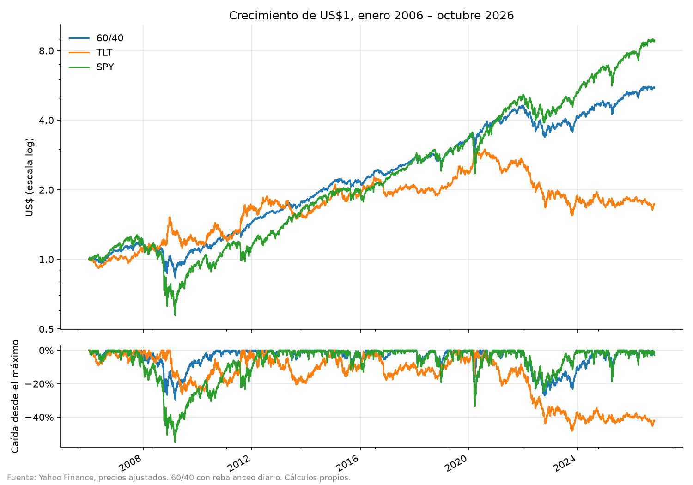

# Quant como hobby

Repositorio de mi plan para aprender finanzas cuantitativas como hobby (noviembre 2026 – enero 2028): desde las bases de Python y estadística hasta operar una estrategia propia con poco dinero real. Aquí guardo mi código, mis gráficas y mi bitácora.

No es asesoría financiera: es un proyecto de aprendizaje.

## Avance

- [x] **Módulo 1 · Python para finanzas.** Rendimientos simples y logarítmicos, descarga y limpieza de precios de 10 ETFs (2006–2026), volatilidad y su anualización, colas gruesas, autocorrelación, correlaciones y un primer portafolio 60/40.
- [ ] Módulo 2 · Cómo funcionan los mercados
- [ ] Módulo 3 · Estadística de rendimientos
- [ ] Módulo 4 · Backtesting bien hecho

## Estructura

| Carpeta o archivo | Qué contiene |
| --- | --- |
| `notebooks/` | Mi código, un notebook por tema. |
| `figuras/` | Las gráficas que generan los notebooks. |
| `bitacora.md` | Lo que aprendí, lo que me sorprendió y lo que quiero probar, semana a semana. |
| `quant_interview_questions/` | Problemas tipo entrevista quant que resolví y me parecieron interesantes. |
| `data/` | No está en el repositorio: los precios se descargan de Yahoo Finance con el notebook `04_etfs.ipynb`. Así el repositorio pesa poco y no redistribuyo datos de terceros. |

## Cómo reproducirlo

En Windows PowerShell, con Python 3.11 o más reciente:

    git clone https://github.com/isaacjimenezu/quant-hobby.git
    cd quant-hobby
    py -m venv .venv
    .\.venv\Scripts\Activate.ps1
    python -m pip install -r requirements.txt

Después, corre `notebooks/04_etfs.ipynb` para descargar los precios y guardarlos en `data/precios_etfs.csv`. Los demás notebooks leen ese archivo.

Ojo: los precios ajustados de Yahoo cambian cada vez que un ETF paga dividendos, así que una descarga nueva puede dar números ligeramente distintos.

## Resultado destacado

Un dólar invertido en enero de 2006 se volvió unos 9 dólares en SPY y unos 5.5 en un portafolio 60/40 (SPY y TLT, rebalanceado a diario). A cambio, el 60/40 redujo la peor caída casi a la mitad: −30 % contra −55 % de SPY en marzo de 2009. Los bonos del Tesoro de largo plazo (TLT) no siempre protegen: cayeron 48 % entre 2020 y octubre de 2023, cuando subieron las tasas.